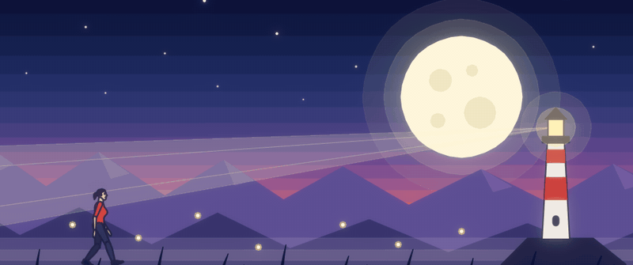
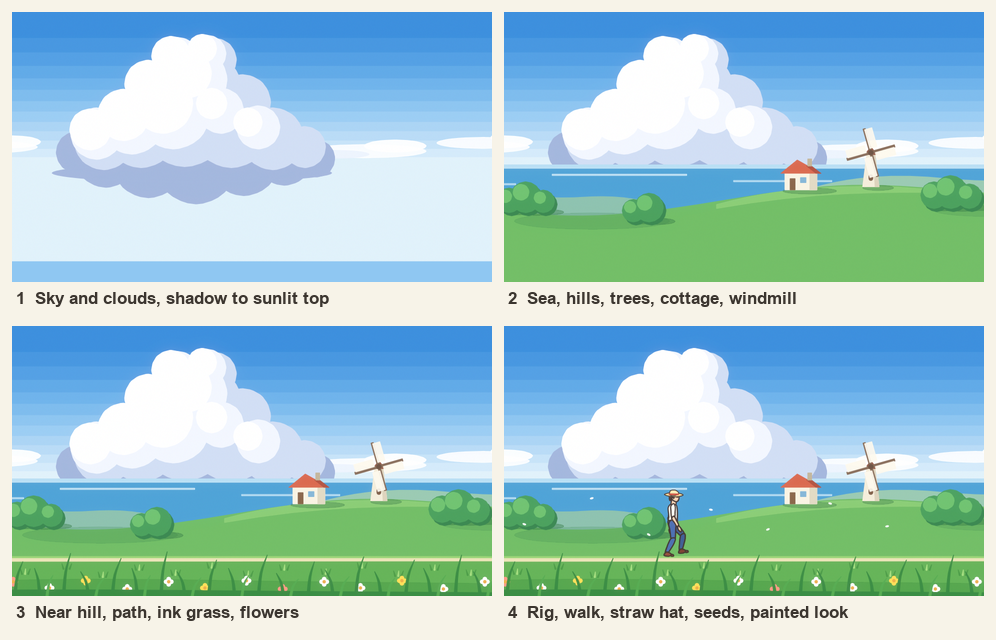
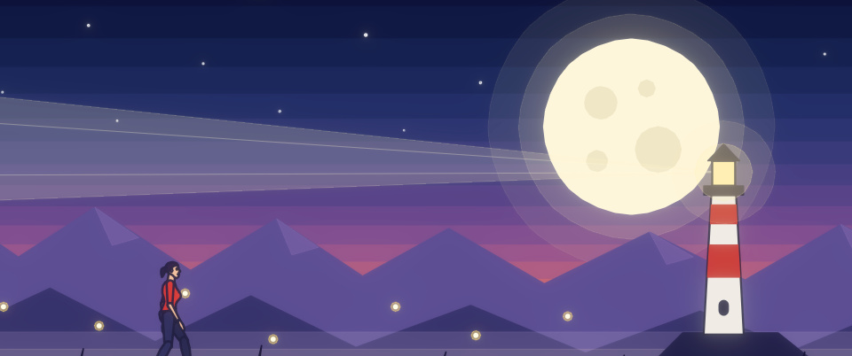
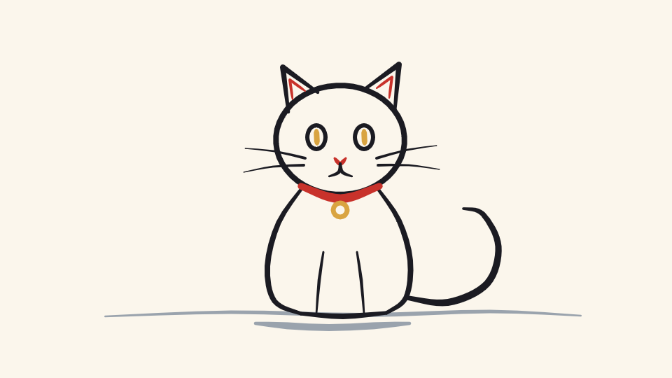
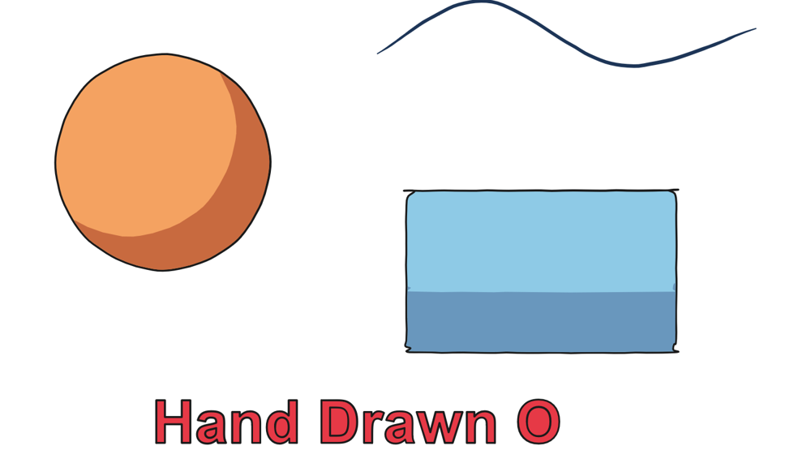
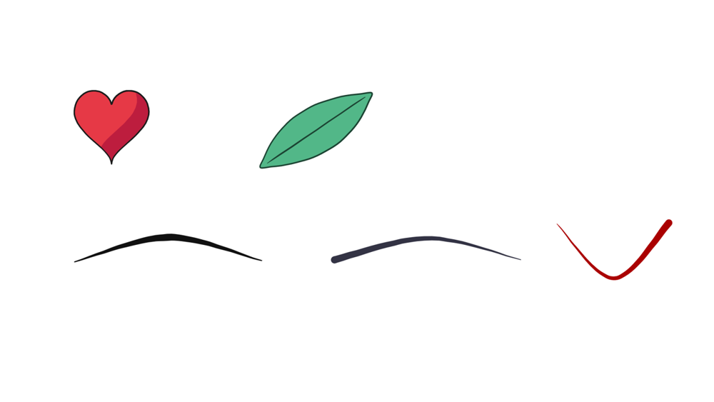

<!-- mcp-name: io.github.konkomaji/opentoonz-mcp -->

<div align="center">

# OpenToonz MCP

**Let an AI assistant animate inside OpenToonz, the open-source 2D studio tool, and keep every frame editable.**

[](https://github.com/konkomaji/opentoonz-mcp/actions/workflows/ci.yml)
[](https://pypi.org/project/opentoonz-mcp/)
[](https://pypi.org/project/opentoonz-mcp/)
[](https://github.com/konkomaji/opentoonz-mcp/blob/main/LICENSE)
[](https://modelcontextprotocol.io)



<sub><b>Summer hill.</b> An original shot in the hand-painted tradition of Japanese feature animation. 96 frames, 29 layers, ten depth planes, a camera that travels with her, and a soft painted finish. Every drawing is an OpenToonz vector level, every move is a keyframe, and the finish is real OpenToonz fx. Open the scene and change anything.</sub>

<br><br>

<a href="#how-this-shot-was-made">How this shot was made</a> ·
<a href="#draw-together-on-the-same-drawing">Draw together</a> ·
<a href="#install">Install</a> ·
<a href="https://github.com/konkomaji/opentoonz-mcp/blob/main/docs/TOOLS.md">59 tools</a> ·
<a href="https://github.com/konkomaji/opentoonz-mcp/blob/main/docs/DRAWING_TOGETHER.md">Guide</a>

</div>

---

## At a glance

| | |
|:--|:--|
| **59 tools** | scenes, layers, drawing, ink strokes, paint, timing, keyframes, physics, rigs, walk and run, camera, fx looks, render |
| **196 tests** | 57 of them drive the real OpenToonz: they render and compare pixels, or draw in its open window |
| **3 ways to draw** | shapes and SVG paths · pen strokes on a shared ink layer · your own art, placed or traced |
| **2 ways to work together** | through the files, with any OpenToonz 1.8 · live in your open window, with the otbridge plugin |
| **Windows and Linux** | unit tests run on both in CI; rendering is tested on Windows and confirmed on Linux by a user |

## How this shot was made



The whole shot is 47 tool calls. No frame was painted by hand and no image or video model was involved. In order:

| Step | Tools | What happened |
|:--|:--|:--|
| **1. Layout** | `create_scene` `add_note` `add_layer` ×9 | A 96-frame scene at 24 fps, with the layers back to front. The grass texture on the slope is an ink layer. |
| **2. Sky** | `draw` | Thirteen bands of blue, deep overhead and pale at the horizon. |
| **3. Clouds** | `draw` ×2 | The big cumulus is 37 shapes in four tones, laid in the order a background painter works: shaded underside, body, light turning into shade, then the tops the sun reaches. Flat clouds and a smaller tower sit on the horizon. |
| **4. Sea and hills** | `draw` ×3 | A strip of sea with a bright horizon line, two far headlands, then the middle hill with eleven trees, a cloud's shadow on the grass, a cottage and a windmill tower. |
| **5. Windmill sails** | `draw` | The sails are their own layer, so they can turn. |
| **6. Near hill** | `draw` `stroke` | The bank she walks on, its sunlit top and worn path, and 54 short pen marks of grass. |
| **7. Character** | `build_character` `walk_cycle` `add_layer` `draw` | A 16-part rig with a ten-year-old's proportions and a happy walk: planted rolling feet, two-bone leg IK, hips on an inverted-pendulum arc. Her straw hat is a layer parented to the head, so it follows every nod. |
| **8. Foreground** | `add_layer` ×3 `draw` ×2 `stroke` ×3 | Eighteen flowers, 43 blades of grass as single pen strokes thick at the root and thin at the tip, and eight seeds in the air. |
| **9. Motion** | `set_pivot` `set_keyframe` ×9 | The sails turn about their hub, both cloud layers drift, the seeds ride the wind. |
| **10. Camera** | `camera_move` ×2 | A slight push in and a 150 px pan that travels with her. Each plane moves at its own speed: sky 2 %, the big cloud 8 %, sea 14 %, middle hill 45 %, her hill 100 %, flowers 150 %, grass 170 %. |
| **11. Finish** | `apply_look` | The `ghibli` look preset: gentle bloom on the highlights, a slightly warmer grade and fine paper grain, as OpenToonz fx nodes you can open in the FX Schematic. |
| **12. Check and render** | `validate_scene` `render` | OpenToonz rendered 96 frames in about 40 seconds. The server checked the frame count, blank frames and flashing. |

The exact calls, with every coordinate, are in [`docs/media/making_of_summer_hill.py`](https://github.com/konkomaji/opentoonz-mcp/blob/main/docs/media/making_of_summer_hill.py). Run it and you get the same scene, ready to edit in OpenToonz.

<details>
<summary><b>Another shot: Night walk</b> (moonrise, a lighthouse beam, a bloom pass)</summary>
<br>


41 tool calls: [`docs/media/making_of_nightwalk.py`](https://github.com/konkomaji/opentoonz-mcp/blob/main/docs/media/making_of_nightwalk.py).
</details>

## Draw together, on the same drawing

<table>
<tr>
<td width="56%"></td>
<td>

Every line of this cat is one pen stroke the assistant placed with the `stroke` tool: 26 strokes, each with its own pressure, written straight into an OpenToonz vector level. No script generated it and nothing was traced.

That level is an **ink layer**. You and the assistant both draw on it:

- **It sees your lines.** `read_drawing` returns every stroke on the drawing, yours included.
- **It adds, it never replaces.** New strokes go on top. Your lines and your paint stay.
- **It paints and it looks.** In live mode `paint` fills closed areas, and `live_view` shows it your viewer as you see it.
- **It can be live.** With the optional [otbridge plugin](https://github.com/konkomaji/opentoonz-mcp/blob/main/bridge/README.md), strokes appear in your open OpenToonz window as they are drawn, and Ctrl+Z takes them back.

The guide is **[docs/DRAWING_TOGETHER.md](https://github.com/konkomaji/opentoonz-mcp/blob/main/docs/DRAWING_TOGETHER.md)**.

</td>
</tr>
</table>

## Why I built this

Most "AI animation" today produces a finished video you can't edit. Animators need the opposite: drawings they can fix, timing they can retime, and a scene they can hand to the next person in the pipeline.

OpenToonz is the open-source release of Toonz, the software Studio Ghibli customised and used on its films. It already has everything a 2D pipeline needs: vector levels, an xsheet, pegbars, cameras and a compositor. What it lacked was a way for an assistant to *use* it.

OpenToonz MCP is that bridge. You describe a shot. The assistant lays it out, draws key poses, in-betweens them, times them on ones, twos or threes, adds camera work, and renders. The result is a normal OpenToonz scene. You can open it, change anything, save it, and ask the assistant to continue. Your edits are kept.

— **konkomaji** · [konkomaji.com](https://konkomaji.com/)

## Who it's for

- **Animators and directors** who want fast layouts, animatics, in-betweens and camera passes they can then finish by hand.
- **Indie studios and solo creators** making shorts, explainers, music videos or game cutscenes without a full crew.
- **Teachers and students** of animation. The tools follow the classic principles (slow in/out, arcs, anticipation, follow-through), so the output is a worked example you can inspect frame by frame.
- **Developers** building creative AI tools who need a real, inspectable 2D pipeline rather than pixels.

## What it can do

| | |
|---|---|
| 🎨 **Native vector drawing** | Shapes, SVG paths and pressure brush strokes become OpenToonz `.pli` vector levels. OpenToonz performs the conversion itself, so the drawings are fully editable with OpenToonz's vector tools. |
| ✍️ **A hand-drawn look** | Pen-pressure taper. Subtle line wobble that holds still on held frames. Optional line boil. Anime cel shadows or pen hatching (inspired by p5.brush), and coloured trace lines. Style presets: `anime`, `feature`, `cartoon`, `sketch`, `clean`. |
| 🎞️ **Animator timing** | In-betweens with slow-in/slow-out, arcs and squash and stretch that keeps the area constant. Xsheet exposure on ones, twos or threes. Blinks and lip sync from text. |
| 🦘 **Principles built in** | `animate_action` adds anticipation, overshoot and settle using classic proportions. Physics tools do gravity-exact bounces (with material presets), recipe jumps, and spring-based follow-through for hair, tails and cloth. |
| 🧍 **Real human bodies that walk and run** | `build_character` makes a side-view cut-out rig for any age and sex (toddler, girl, boy, teen, woman, man, old woman, old man) from published body measurements, optionally with regional averages from national health surveys (for example the US, India, West Bengal, Japan, the UK or Nigeria). `walk_cycle` and `run_cycle` animate it from gait studies: planted feet that roll heel to toe, two-bone leg IK, an inverted-pendulum walk and a spring-mass run with exact gravity in the air. Each call reports cadence, step length, knee angles and foot slip so you can check the motion. |
| 🎬 **Studio looks** | `apply_look` adds a ghibli, klaus, spider_verse, comic, anime_satsuei, painterly or cartoon_saloon look as real OpenToonz fx nodes (bloom, form shadow and rim light, offset colour plates, grain). They stay editable in the FX Schematic, and `remove_look` takes them out cleanly. |
| 🎥 **Camera work** | Pans with parallax layers, exponential trucks, impact and trauma shake, and a smoothed camera follow. It warns before a move reveals empty background or pans fast enough to strobe. |
| 🖼️ **Bring your own art** | Import SVG files as editable shapes. Place images, or let OpenToonz's own vectorizer trace them into vector levels. Build a reusable **parts library** (model sheets with variants such as mouth charts). |
| 🔁 **Works with your hand edits** | The scene file is the source of truth. Retime or redraw in OpenToonz, save, and the assistant picks up your changes instead of overwriting them. |
| 🤝 **Draw on the same drawing** | An **ink layer** is one vector level you and the assistant both draw on. `read_drawing` shows it every stroke that is there, yours included. `stroke` adds pen lines with pressure on top, straight into the `.pli`, without touching your lines or your paint. `erase_stroke` takes lines out. Nothing is regenerated, and your edits never lock the layer. With the optional **[otbridge plugin](https://github.com/konkomaji/opentoonz-mcp/blob/main/bridge/README.md)** this is live: strokes appear in your open OpenToonz window as they are drawn, the assistant sees your unsaved strokes, and Ctrl+Z takes its lines back. |
| 🛡️ **Safe by design** | Every edit takes a snapshot first. Failed calls roll back automatically. `undo` restores scenes and drawings exactly, writes are verified before they land, and per-scene locks protect against concurrent writers. |
| 🧠 **Remembers and improves** | It keeps notes and a journal per scene. Errors, render reviews and your feedback become ranked lessons that later sessions see, and `tune_style` makes preferred defaults permanent. |

<table>
<tr>
<td></td>
<td></td>
</tr>
<tr>
<td align="center"><sub>Cel shadow, wobble and pressure taper, rendered by OpenToonz</sub></td>
<td align="center"><sub>SVG paths and brush strokes with per-point pressure</sub></td>
</tr>
</table>

## Requirements

- **OpenToonz 1.8** on Windows. The server auto-detects the install and the "stuff" folder from OpenToonz's registry entries.
- **Python 3.10+**.
- **ffmpeg** on `PATH` for MP4 and GIF output (PNG sequences work without it).

## Install

```bash
pip install opentoonz-mcp
# or run without installing:
uvx opentoonz-mcp
```

> **Use pip 26.2.2+ or uv 0.13.4+.** Older versions still trust the emSign certificate authority that was pulled after the [October 2026 eMudhra incident](https://discuss.python.org/t/information-for-python-users-regarding-emudhra-emsign-ca-certificate-security-incident/109576). Upgrade first with `python -m pip install --upgrade pip certifi` or `UV_SYSTEM_CERTS=true uv self update`. The package itself requires `certifi>=2026.10.19`.

### Claude Code

```bash
claude mcp add opentoonz -- uvx opentoonz-mcp
```

### Claude Desktop, Cursor and other MCP clients

```json
{
  "mcpServers": {
    "opentoonz": {
      "command": "uvx",
      "args": ["opentoonz-mcp"],
      "env": {
        "OPENTOONZ_HOME": "C:\\Program Files\\OpenToonz",
        "OPENTOONZ_STUFF": "C:\\OpenToonz stuff"
      }
    }
  }
}
```

The `env` block is optional. Use it only if auto-detection picks the wrong install.

| Variable | Meaning | Default |
|---|---|---|
| `OPENTOONZ_HOME` | Folder containing `OpenToonz.exe` and `tcomposer.exe` | detected from the Windows uninstall entry, then `C:\Program Files\OpenToonz` |
| `OPENTOONZ_STUFF` | OpenToonz "stuff" folder (TOONZROOT) | detected from `HKLM\SOFTWARE\OpenToonz\OpenToonz` |
| `OTMCP_WORK` | Where state, undo snapshots, renders and lessons are kept | `%LOCALAPPDATA%\opentoonz-mcp` |

Ask the assistant to run `opentoonz_info` first. It reports what it found and anything missing.

### Set up, step by step

1. **Install OpenToonz 1.8** from [opentoonz.github.io](https://opentoonz.github.io/e/) and start it once, so it creates its "stuff" folder.
2. **Install ffmpeg** if you want MP4 or GIF output (`winget install Gyan.FFmpeg`).
3. **Add the server to your MCP client** with one of the snippets above. Nothing else needs installing; `uvx` fetches the package.
4. **Restart the client**, then ask: *"Run opentoonz_info."* You should see the OpenToonz version and both folders. If a path is wrong, set `OPENTOONZ_HOME` and `OPENTOONZ_STUFF`.
5. **Make something small**: *"Create a 2-second scene with a red ball that bounces twice, and show me a contact sheet."*
6. **Open it in OpenToonz**: *"Open the scene in OpenToonz."* Everything you see is editable.

To upgrade: `pip install -U opentoonz-mcp` (with `uvx`, run `uvx opentoonz-mcp@latest` once), then restart the client. Scenes made with 0.1.0 keep working.

To draw together, add step 7: *"Add an ink layer called sketch."* Draw on it in OpenToonz, save, and ask the assistant to look at your drawing and continue. [docs/DRAWING_TOGETHER.md](https://github.com/konkomaji/opentoonz-mcp/blob/main/docs/DRAWING_TOGETHER.md) walks through it.

### Optional: live drawing (otbridge)

Everything works without this. Install it if you want the assistant's strokes to appear in your open OpenToonz window as they are drawn.

The plugin is C++ and has to be compiled for the exact OpenToonz you run, so it is not in the pip package as a binary. The source and a build script are in [`bridge/`](https://github.com/konkomaji/opentoonz-mcp/blob/main/bridge/README.md):

```
python bridge/build.py --opentoonz "C:\Program Files\OpenToonz" --source <opentoonz source> --qt <Qt 5.15.2 msvc2019_64> --install
```

Restart OpenToonz, then ask the assistant for `opentoonz_live`. It is built and tested for the official OpenToonz 1.8.0 Windows build, and it switches itself off in any other build instead of risking a crash.

## Try it

> Create a 4-second anime-style scene of a round mochi character on a hill. It blinks, crouches, jumps and lands with squash and stretch while the camera pans right with parallax. Then render an MP4.

> Import my sketch `C:\art\pose.png` on a traced layer with centerline tracing, then in-between it to the next key on twos.

> Build an old woman and a seven-year-old girl, and have them walk across the frame together.

> Open the scene in OpenToonz. I'll fix the arm on frame 12. … Done: carry on from frame 13.

> Make an ink layer called `rough`. I'll sketch the pose in OpenToonz. … Look at my drawing and add the hands and the hair on top, in a darker line.

> I have the scene open. Draw the whiskers on the cat's face while I watch, a few strokes at a time.

A good session looks like a studio pipeline:

1. `scene_context` (always first)
2. `create_scene`
3. `add_note` (story)
4. Layout: layers, pegs and camera
5. Key drawings, then `inbetween` and timing
6. `set_pivot`, then keys, `animate_action` and physics (or `build_character` and `walk_cycle` for people)
7. `camera_move`, then `apply_look` for a studio finish
8. `validate_scene`, `contact_sheet`, `render`

Drawing together is a shorter loop, repeated:

1. `add_layer(mode="ink")`, or `ink_layer` on a layer you already have
2. `read_drawing` (what is there, and who drew it)
3. `stroke` (a few lines)
4. `preview_frame` (look), then back to 2

The full list of 59 tools with every parameter is in **[docs/TOOLS.md](https://github.com/konkomaji/opentoonz-mcp/blob/main/docs/TOOLS.md)**.

## How it works

```
assistant ──MCP──► opentoonz-mcp ──► .tnz scene (edited in place, lossless)
                         │
                         ├─► SVG drawings ──► OpenToonz.exe (headless script) ──► native .pli ──► pen pressure
                         ├─► images ───────► OpenToonz vectorizer ───────────────► traced .pli
                         ├─► pen strokes ──► written straight into the .pli (ink layers; your strokes stay)
                         │        └─ or, when the scene is open in OpenToonz with otbridge ──► live in your viewer
                         └─► tcomposer.exe (OpenToonz's renderer) ──► PNG ──► ffmpeg ──► MP4 / GIF
```

Everything that touches OpenToonz data is checked against OpenToonz itself. The keyframe interpolation, for example, is a port of OpenToonz's evaluator, and tests compare it frame by frame with real `tcomposer` renders (within 1.5 px).

The same rule holds for ink layers. The `.pli` editor rewrites every level in my test folder byte for byte, and OpenToonz saves a level written by it back unchanged.

| Document | What is in it |
|---|---|
| [docs/DRAWING_TOGETHER.md](https://github.com/konkomaji/opentoonz-mcp/blob/main/docs/DRAWING_TOGETHER.md) | Ink layers and live drawing: the workflow, the tools, worked examples, limits |
| [bridge/README.md](https://github.com/konkomaji/opentoonz-mcp/blob/main/bridge/README.md) | The otbridge plugin: build, install, safety, protocol |
| [docs/TOOLS.md](https://github.com/konkomaji/opentoonz-mcp/blob/main/docs/TOOLS.md) | Every tool and parameter |
| [docs/ARCHITECTURE.md](https://github.com/konkomaji/opentoonz-mcp/blob/main/docs/ARCHITECTURE.md) | Modules, the per-call transaction, layer modes, live mode |
| [docs/FORMAT_NOTES.md](https://github.com/konkomaji/opentoonz-mcp/blob/main/docs/FORMAT_NOTES.md) | The OpenToonz file-format facts the code depends on, each one verified |
| [docs/WHITEPAPER.md](https://github.com/konkomaji/opentoonz-mcp/blob/main/docs/WHITEPAPER.md) | The design and the reasoning behind it |

## Limitations

- **Windows first, Linux second.** It is developed and render-tested on Windows with OpenToonz 1.8. The unit tests also run on Linux in CI, and a user runs the whole suite against OpenToonz 1.8.0 built from source on Linux; set `OPENTOONZ_HOME` and `OPENTOONZ_STUFF` there. macOS is untested.
- **Drawing comes from shapes, paths, brush strokes and imported art.** There is no built-in image generator. Bring your own art, or have the assistant compose it from paths and parts.
- **A shape layer has one author at a time.** A `vector` layer is rebuilt from the assistant's shapes. If you redraw it in the GUI, the assistant won't overwrite your work unless told to (`force=true`). To keep drawing on it together, turn it into an ink layer with `ink_layer`.
- **Live drawing needs the otbridge plugin, and it exists for one build so far.** It is compiled for the official OpenToonz 1.8.0 Windows build and refuses to start in any other. Without it, OpenToonz does not reload a level that changed on disk: after the assistant draws, use File > Revert Scene to see it, and save your own strokes before asking it to draw. Ink strokes are lines only: paint areas in OpenToonz, or use a vector layer.
- **Render tests need a local OpenToonz.** CI runs the unit tests only.

## Contributing

Issues and pull requests are welcome. See [CONTRIBUTING.md](https://github.com/konkomaji/opentoonz-mcp/blob/main/CONTRIBUTING.md). Changes are recorded in [CHANGELOG.md](https://github.com/konkomaji/opentoonz-mcp/blob/main/CHANGELOG.md).

## Credits

- Built by **[konkomaji](https://konkomaji.com/)**.
- Powered by **[OpenToonz](https://github.com/opentoonz/opentoonz)** (BSD-3-Clause), which is not bundled. Thank you to DWANGO, the original Toonz team at Digital Video, Studio Ghibli, and every OpenToonz contributor. See [NOTICE](https://github.com/konkomaji/opentoonz-mcp/blob/main/NOTICE).
- This project is not affiliated with OpenToonz, DWANGO, Digital Video or Studio Ghibli.

Released under the [MIT License](https://github.com/konkomaji/opentoonz-mcp/blob/main/LICENSE).
