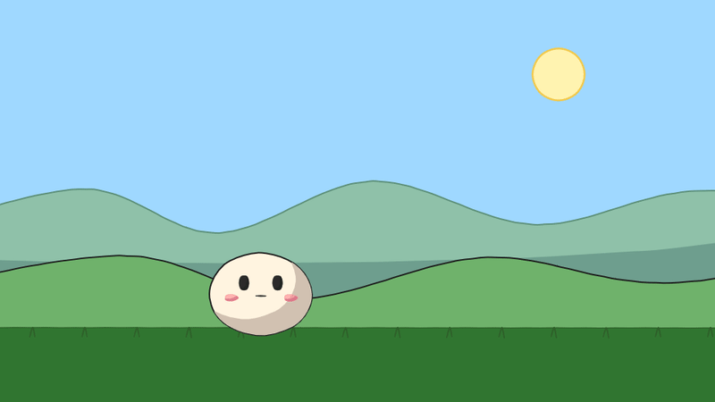
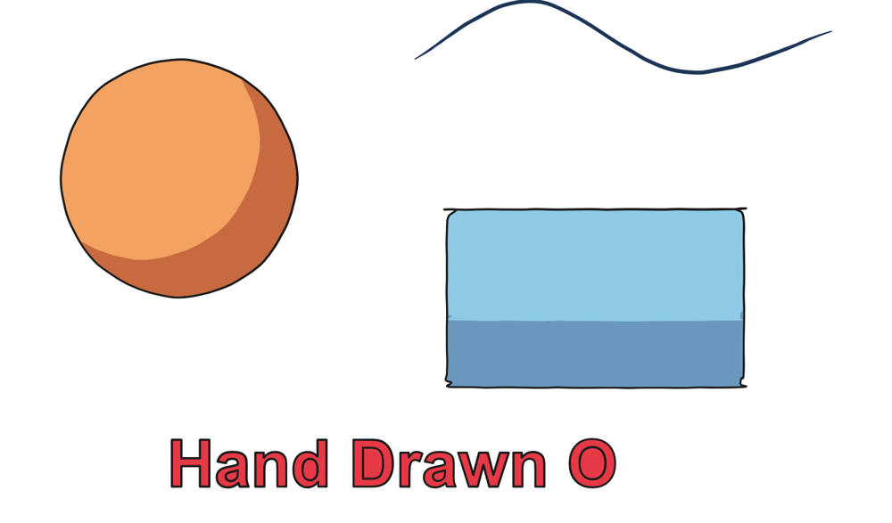
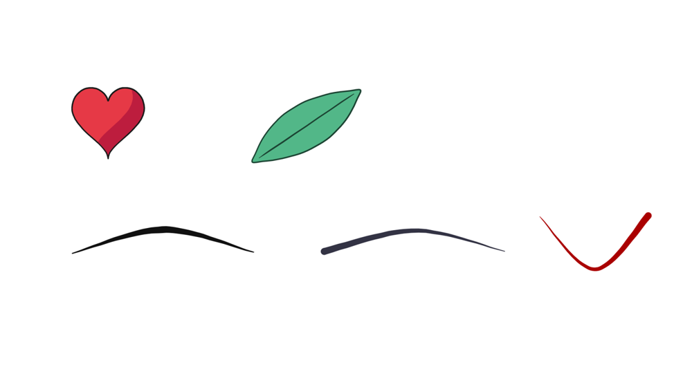

<!-- mcp-name: io.github.konkomaji/opentoonz-mcp -->

<div align="center">

# OpenToonz MCP

**Let an AI assistant animate inside OpenToonz, the open-source 2D studio tool, and keep every frame editable.**

[](https://github.com/konkomaji/opentoonz-mcp/actions/workflows/ci.yml)
[](CHANGELOG.md)
[](pyproject.toml)
[](LICENSE)
[](https://modelcontextprotocol.io)



<sub>Made entirely with this server's tools. The character, background and timing are real OpenToonz vector levels, xsheet cells and keyframes, so you can open the scene and keep animating by hand.</sub>

</div>

---

## Why I built this

Most "AI animation" today produces a finished video you can't edit. Animators need the opposite: drawings they can fix, timing they can retime, and a scene they can hand to the next person in the pipeline.

OpenToonz is the open-source release of Toonz, the software Studio Ghibli customised and used on its films. It already has everything a 2D pipeline needs: vector levels, an xsheet, pegbars, cameras and a compositor. What it lacked was a way for an assistant to *use* it.

OpenToonz MCP is that bridge. You describe a shot. The assistant lays it out, draws key poses, in-betweens them, times them on ones, twos or threes, adds camera work, and renders. The result is a normal OpenToonz scene. You can open it, change anything, save it, and ask the assistant to continue. Your edits are kept.

— **konkomaji** · [konkomaji.com](https://konkomaji.com/)

## Who it's for

- **Animators and directors** who want fast layouts, animatics, in-betweens and camera passes they can then finish by hand.
- **Indie studios and solo creators** making shorts, explainers, music videos or game cutscenes without a full crew.
- **Teachers and students** of animation. The tools follow the classic principles (slow in/out, arcs, anticipation, follow-through), so the output is a worked example you can inspect frame by frame.
- **Developers** building creative AI tools who need a real, inspectable 2D pipeline rather than pixels.

## What it can do

| | |
|---|---|
| 🎨 **Native vector drawing** | Shapes, SVG paths and pressure brush strokes become OpenToonz `.pli` vector levels. OpenToonz performs the conversion itself, so the drawings are fully editable with OpenToonz's vector tools. |
| ✍️ **A hand-drawn look** | Pen-pressure taper. Subtle line wobble that holds still on held frames. Optional line boil. Anime cel shadows or pen hatching (inspired by p5.brush), and coloured trace lines. Style presets: `anime`, `feature`, `cartoon`, `sketch`, `clean`. |
| 🎞️ **Animator timing** | In-betweens with slow-in/slow-out, arcs and squash and stretch that keeps the area constant. Xsheet exposure on ones, twos or threes. Blinks and lip sync from text. |
| 🦘 **Principles built in** | `animate_action` adds anticipation, overshoot and settle using classic proportions. Physics tools do gravity-exact bounces (with material presets), recipe jumps, and spring-based follow-through for hair, tails and cloth. |
| 🧍 **Real human bodies that walk and run** | `build_character` makes a side-view cut-out rig for any age and sex (toddler, girl, boy, teen, woman, man, old woman, old man) from published body measurements, optionally with regional averages from national health surveys (for example the US, India, West Bengal, Japan, the UK or Nigeria). `walk_cycle` and `run_cycle` animate it from gait studies: planted feet that roll heel to toe, two-bone leg IK, an inverted-pendulum walk and a spring-mass run with exact gravity in the air. Each call reports cadence, step length, knee angles and foot slip so you can check the motion. |
| 🎬 **Studio looks** | `apply_look` adds a ghibli, klaus, spider_verse, comic, anime_satsuei, painterly or cartoon_saloon look as real OpenToonz fx nodes (bloom, form shadow and rim light, offset colour plates, grain). They stay editable in the FX Schematic, and `remove_look` takes them out cleanly. |
| 🎥 **Camera work** | Pans with parallax layers, exponential trucks, impact and trauma shake, and a smoothed camera follow. It warns before a move reveals empty background or pans fast enough to strobe. |
| 🖼️ **Bring your own art** | Import SVG files as editable shapes. Place images, or let OpenToonz's own vectorizer trace them into vector levels. Build a reusable **parts library** (model sheets with variants such as mouth charts). |
| 🔁 **Works with your hand edits** | The scene file is the source of truth. Retime or redraw in OpenToonz, save, and the assistant picks up your changes instead of overwriting them. |
| 🛡️ **Safe by design** | Every edit takes a snapshot first. Failed calls roll back automatically. `undo` restores scenes and drawings exactly, writes are verified before they land, and per-scene locks protect against concurrent writers. |
| 🧠 **Remembers and improves** | It keeps notes and a journal per scene. Errors, render reviews and your feedback become ranked lessons that later sessions see, and `tune_style` makes preferred defaults permanent. |

<table>
<tr>
<td></td>
<td></td>
</tr>
<tr>
<td align="center"><sub>Cel shadow, wobble and pressure taper, rendered by OpenToonz</sub></td>
<td align="center"><sub>SVG paths and brush strokes with per-point pressure</sub></td>
</tr>
</table>

## Requirements

- **OpenToonz 1.8** on Windows. The server auto-detects the install and the "stuff" folder from OpenToonz's registry entries.
- **Python 3.10+**.
- **ffmpeg** on `PATH` for MP4 and GIF output (PNG sequences work without it).

## Install

It isn't on PyPI yet, so for now I install it straight from GitHub:

```bash
pip install git+https://github.com/konkomaji/opentoonz-mcp
# or run without installing:
uvx --from git+https://github.com/konkomaji/opentoonz-mcp opentoonz-mcp
```

### Claude Code

```bash
claude mcp add opentoonz -- uvx --from git+https://github.com/konkomaji/opentoonz-mcp opentoonz-mcp
```

### Claude Desktop, Cursor and other MCP clients

```json
{
  "mcpServers": {
    "opentoonz": {
      "command": "uvx",
      "args": ["--from", "git+https://github.com/konkomaji/opentoonz-mcp", "opentoonz-mcp"],
      "env": {
        "OPENTOONZ_HOME": "C:\\Program Files\\OpenToonz",
        "OPENTOONZ_STUFF": "C:\\OpenToonz stuff"
      }
    }
  }
}
```

The `env` block is optional. Use it only if auto-detection picks the wrong install.

| Variable | Meaning | Default |
|---|---|---|
| `OPENTOONZ_HOME` | Folder containing `OpenToonz.exe` and `tcomposer.exe` | detected from the Windows uninstall entry, then `C:\Program Files\OpenToonz` |
| `OPENTOONZ_STUFF` | OpenToonz "stuff" folder (TOONZROOT) | detected from `HKLM\SOFTWARE\OpenToonz\OpenToonz` |
| `OTMCP_WORK` | Where state, undo snapshots, renders and lessons are kept | `%LOCALAPPDATA%\opentoonz-mcp` |

Ask the assistant to run `opentoonz_info` first. It reports what it found and anything missing.

## Try it

> Create a 4-second anime-style scene of a round mochi character on a hill. It blinks, crouches, jumps and lands with squash and stretch while the camera pans right with parallax. Then render an MP4.

> Import my sketch `C:\art\pose.png` on a traced layer with centerline tracing, then in-between it to the next key on twos.

> Build an old woman and a seven-year-old girl, and have them walk across the frame together.

> Open the scene in OpenToonz. I'll fix the arm on frame 12. … Done: carry on from frame 13.

A good session looks like a studio pipeline:

1. `scene_context` (always first)
2. `create_scene`
3. `add_note` (story)
4. Layout: layers, pegs and camera
5. Key drawings, then `inbetween` and timing
6. `set_pivot`, then keys, `animate_action` and physics (or `build_character` and `walk_cycle` for people)
7. `camera_move`, then `apply_look` for a studio finish
8. `validate_scene`, `contact_sheet`, `render`

The full list of 52 tools with every parameter is in **[docs/TOOLS.md](docs/TOOLS.md)**.

## How it works

```
assistant ──MCP──► opentoonz-mcp ──► .tnz scene (edited in place, lossless)
                         │
                         ├─► SVG drawings ──► OpenToonz.exe (headless script) ──► native .pli ──► pen pressure
                         ├─► images ───────► OpenToonz vectorizer ───────────────► traced .pli
                         └─► tcomposer.exe (OpenToonz's renderer) ──► PNG ──► ffmpeg ──► MP4 / GIF
```

Everything that touches OpenToonz data is checked against OpenToonz itself. The keyframe interpolation, for example, is a port of OpenToonz's evaluator, and tests compare it frame by frame with real `tcomposer` renders (within 1.5 px).

The details are in [docs/WHITEPAPER.md](docs/WHITEPAPER.md), [docs/ARCHITECTURE.md](docs/ARCHITECTURE.md) and [docs/FORMAT_NOTES.md](docs/FORMAT_NOTES.md).

## Limitations

- **Windows first.** It is developed and tested on Windows with OpenToonz 1.8. Other platforms may work with `OPENTOONZ_HOME` set, but they are untested.
- **Drawing comes from shapes, paths, brush strokes and imported art.** There is no built-in image generator. Bring your own art, or have the assistant compose it from paths and parts.
- **Redrawing replaces your edits on that layer.** If you redraw, in the GUI, a layer the assistant drew, the assistant won't overwrite it unless told to (`force=true`).
- **Render tests need a local OpenToonz.** CI runs the unit tests only.

## Contributing

Issues and pull requests are welcome. See [CONTRIBUTING.md](CONTRIBUTING.md). Changes are recorded in [CHANGELOG.md](CHANGELOG.md).

## Credits

- Built by **[konkomaji](https://konkomaji.com/)**.
- Powered by **[OpenToonz](https://github.com/opentoonz/opentoonz)** (BSD-3-Clause), which is not bundled. Thank you to DWANGO, the original Toonz team at Digital Video, Studio Ghibli, and every OpenToonz contributor. See [NOTICE](NOTICE).
- This project is not affiliated with OpenToonz, DWANGO, Digital Video or Studio Ghibli.

Released under the [MIT License](LICENSE).
